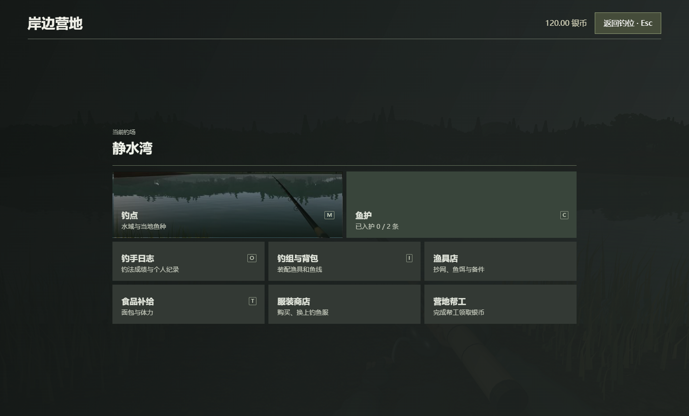

# 钓鱼桌面 · Fishing Desktop

面向 Windows 的写实互动钓鱼动态壁纸项目。

**[下载 Windows x64 离线版 0.7.0](https://github.com/kaiwer1/fishing-desktop/releases/tag/v0.7.0)**。选择 `FishingDesktop-0.7.0-win-x64.zip`，整包解压后双击根目录的 `FishingDesktop.exe`。选择「窗口试玩」，在横向窗口顶部点「开启交互」。选择「设为桌面」则在桌面图标后播放钓场，双击托盘图标可打开交互窗。安装好 .NET Framework 4.6.2 或更高版本及 Microsoft Edge WebView2 运行时后，可在 64 位 Windows 上离线游玩。

在水面按住左键，看到力度条后松开抛竿。漂尾下沉时按右键提竿，中鱼后按住左键收线。**F1** 可随时在岸边查操作。按 **Esc** 打开营地，**M** 选钓场，**C** 进鱼护，**T** 进食品店。在菜单内就能买装备、换衣和卖鱼。

**0.7.0 可以在江湾用亮片钓翘嘴鲌，在海湾用蚯蚓底钓大黄鱼。** 按 M 选水域，到渔具店选择已购套装。找翘嘴鲌可在晨昏走到草滩尾，松开左键抛出亮片，入水后再次按住左键沿上层收饵。找大黄鱼可在夜间从礁台向外侧沙底抛竿。等竿尖明显下压再用右键提竿。静水湾架多支竿时，按 F1 可开启竿架鱼讯铃，听音高分辨槽号。[翘嘴鲌实机画面](docs/preview-0.7/topmouth-culter.png) · [大黄鱼实机画面](docs/preview-0.7/large-yellow-croaker.png)



浮漂竿有整段软木握柄，底钓竿有黄橙色软尾，路亚竿的前后手柄之间露出一段竿身。收线时能看见鱼线从线杯和导线轮穿过竿身的各个导环。[海湾路亚收线](docs/preview-0.6/spinning-rod.png) · [静水湾底钓](docs/preview-0.6/bottom-tip.png)

**0.6.0 可以沿岸找水深。** 按 **M** 先看钓场的两个推荐落点，回到岸边后用 **A / D** 走到对应位置，停稳再抛。静水湾左边的芦苇口较浅，右边的塘坎较深。江湾正好相反，同样往前抛约 19 米，左边回流口水深约 2.22 米，右边草滩尾约 1.72 米。海湾可以比较沙嘴和礁台。浮漂入护经验满 10 点后按 **O** 学「稳手提竿」，鱼漂沉下后多出 0.75 秒提竿时间。按 **F1** 可切换省电、标准和高清，壁纸也会随之调整。[江湾回流口实机画面](docs/preview-0.6/river-channel.png) · [浮漂技能](docs/preview-0.5/steady-strike.png)

**0.5.0 新玩法。** 江湾的回湾深槽可以用浮漂找黄颡鱼，在海湾外侧的礁坡可以钓许氏平鲉。按 **T** 进食品店，买一份面包，揉成三份面饵，再点「挂面饵」。回岸边抛一竿，在淡水里对照鲤鱼和鲫鱼的鱼口。取消蓄力会保留挂好的饵，只有实际抛出才扣一份。[食品店实机画面](docs/preview-0.5/bread-bait.png) · [升级与退回旧存档](desktop/game-core/FISH_CATALOG.md)

抄鱼入护后按 **C**，点那条鱼旁边的「查看鱼体」。按住左键拖动可以把鱼从侧面转到正面，滚轮放大看鳞片和鳍条，按 Esc 回到鱼护。十一种鱼均有各自的原创模型。[十一种鱼外形对照](docs/preview-0.7/eleven-fish.png)

三个钓场都有各自的天气。开局是早上 07:30，实际游玩一分钟，钓场约过去一小时。可以在天还亮时试一次静水湾浅滩，到晚上再钓同一个落点，看鲫鱼和鲤鱼的鱼口怎么变。切换钓场会沿用当前时刻；打开营地菜单时暂停，退出重开则从早上开始。

[同一钓位的午夜](docs/preview-0.4/ecology-night.png) · [0.4.0 海湾双手摇轮收线](docs/preview-0.4/coastal-retrieve-hands.png)

[海湾亮片渔获](docs/preview-0.4/lure-catch.png) · [静水湾竿架](docs/preview-0.4/multi-rod-stand.png) · [竿架渔获](docs/preview-0.4/multi-rod-catch.png) · [静水湾岸景](docs/preview-0.4/shore-lake.png) · [江湾滩岸](docs/preview-0.4/shore-river.png) · [海湾礁岸](docs/preview-0.4/shore-coast.png)

### 用亮片在海湾钓花鲈

1. 收回未结束的钓组，按 M 前往海湾岩岸。在营地「渔具店」购买 **56 银币**的亮片路亚套装，点「使用亮片路亚」，按 Esc 回岸边。若要留鱼，还需购买并装备 24 银币的抄网。新存档有 120 银币，两件合计 80 银币。
2. 对准水面，按住左键蓄力，松开抛竿。这枚 12 克下沉亮片可重复使用，无需虫饵，每次确认抛出消耗 **2 点体力**。亮片入水后重新按住左键匀收，松手停顿让它下沉。按住 R 并滚动滚轮可切换五档收线速度，画面会显示亮片深度、出线和余线。
3. 看到「鱼已攻击亮片」时按一次右键提竿。中鱼后松开再按左键遛鱼，靠岸后点「抄鱼」或按空格入护。没有中鱼或亮片已触底时，继续按住左键卷回岸边；收回确认后可再次抛投。

### 用浮漂钓第一条鱼

1. **备好抄网。** 按 Esc 进入营地，在「渔具店」购买抄网（24 银币）并装备，再按 Esc 回到钓位。
2. **沿岸选位。** 三维钓场空闲时，按 A / D 或左右方向键沿岸步行，按住 Shift 快走。每个钓位从起点向左、向右各可走 8 米。松开方向键站稳，再把鼠标移到水面。
3. **抛竿和遛鱼。** 看到落点圆环后按住左键蓄力，松开抛竿。漂尾明显下沉时按右键提竿，中鱼后按住左键收线，松开停止收线。
4. **留鱼和出售。** 遛到岸边，出现「抄鱼」时点按钮或按空格。看到「渔获已入护」后按 C，勾选要卖的鱼，核对总价后点「确认出售」。「收回这一竿」会直接结束本竿。

### 在静水湾试底钓

[底钓竿梢与岸景](docs/preview-0.4/bottom-settled.png) · [这根底竿钓到的鲫鱼](docs/preview-0.4/bottom-catch.png)

1. 一竿结束后按 M 前往静水湾，进入营地的「渔具店」。在「单钩底钓套装」点「购买套装」，确认支付 **64.00 银币**。看到「已拥有」后点「使用底钓」，按 Esc 回岸边。第一次要留鱼，还要另外购买并装备 **24.00 银币**的抄网。
2. 用蚯蚓作饵，将鼠标对准静水湾底钓区的水面，按住左键蓄力，松开抛竿。等铅坠落底、钓组稳住，观察明色竿尖。**轻点时继续等，出现「竿尖下压」时按一次右键提竿。** 中鱼后按住左键收线，鱼靠岸时按提示抄鱼。
3. 换钓场后会先拿浮漂竿。在静水湾或海湾都可以到渔具店点「使用底钓」，复用已购买的套装。

### 在静水湾架三支底竿

新存档有 **120 银币**。第一套底竿 64，第二、第三套各 48，三槽竿架 16，抄网 24。备齐三竿、竿架和抄网共 **200 银币**。先花 104 买第一竿、竿架和抄网就能开始，剩余 16 可用于补给；卖鱼后再逐套添竿。余额低于 32、鱼护为空且各竿都已收回时，也可到营地帮工，每完成一分钟并领取可得 8 银币。

1. 在静水湾打开营地「渔具店」，到「三槽竿架与备用底竿」购买竿架，点「进入竿架模式」，再按 Esc 返回岸边。已购底竿起初都在架上。
2. 空手时按 **E** 取最近可拿的竿，或按 **1 / 2 / 3** 取对应槽的竿。左键蓄力、松开抛投，等底钓组沉底稳住、槽位提示进入「等鱼」后，按 **X** 放入最近空位。此时可拿下一竿继续抛投。手里已有可放的竿时，按其他有竿的槽号可直接换竿。
3. 观察每个槽位的竿尖。「竿尖轻点」时继续等；某一槽显示「竿尖下压」时，按对应数字取竿，趁鱼口仍在按右键提竿。左键收线，靠岸后抄鱼。每竿各有鱼口，全套共用鱼饵、体力和鱼护。
4. 要卖鱼，先处理手中的渔获，再依次取回架上仍在水里的竿，点「收回这一竿」。按 C 到鱼护勾选并出售。要添竿或换钓场，先在渔具店点「退出竿架模式」，然后购买或按 M 选新钓场。

三处钓场均可用浮漂。静水湾的底竿使用单钩和铅坠，饵笼仍在开发计划中。渔具、食品、服装和卖鱼都在营地菜单中办理。

| 钓场 | 可钓鱼种 |
| --- | --- |
| 静水湾 | 鲤鱼、鲫鱼 |
| 江湾 | 草鱼、鳊鱼、鲤鱼、黄颡鱼、翘嘴鲌 |
| 海湾 | 黑鲷、花鲈、黄鳍鲷、许氏平鲉、大黄鱼 |

### 试玩版本与素材

- **0.4.0-preview.8** 在岸边按 **O** 打开钓手日志，可以查每种钓法的抛竿次数、入护次数和经验，也能查到已售渔获的个人最大重量和累计收入。[日志实机画面](docs/preview-0.4/angler-log.png) · [第八版下载](https://github.com/kaiwer1/fishing-desktop/releases/tag/v0.4.0-preview.8)

- **0.4.0-preview.7** 鱼护新增七种原创三维模型与近看操作，使用所选渔获的真实种类、重量，无需联网。[第七版下载](https://github.com/kaiwer1/fishing-desktop/releases/tag/v0.4.0-preview.7)

- **0.4.0-preview.6** 昼夜、当地天气与鱼情接入三个钓场。保持原有存档格式。[第六版下载](https://github.com/kaiwer1/fishing-desktop/releases/tag/v0.4.0-preview.6)

- **0.4.0-preview.5** 在海湾岩岸可用单枚下沉亮片钓花鲈。升级前先退出游戏，备份 `%LOCALAPPDATA%\FishingDesktop\Preview\game.fltj`，再将新包解压到独立文件夹。上一版正常退出的进度可继续使用。购买路亚套装或用亮片抛竿后，请用第五版读取这些新记录；若要降级，退出游戏后恢复更新前的备份。
- **0.4.0-preview.4** 静水湾开放三槽竿架和两套可逐次购买的备用底竿。[第四版下载](https://github.com/kaiwer1/fishing-desktop/releases/tag/v0.4.0-preview.4)
- **0.4.0-preview.3** 新增静水湾单钩铅坠底钓，三处钓场继续开放浮漂钓法。[第三版下载](https://github.com/kaiwer1/fishing-desktop/releases/tag/v0.4.0-preview.3)
- **0.4.0-preview.2** 加入沿岸走位。静水湾岸土、江湾卵石和海湾礁石分别使用 Poly Haven 的 Forest Ground 04、Floor Pebbles 01 和 Rock 01 三款 CC0 材质。三张贴图随包提供，游玩时从本地读取。[第二版下载](https://github.com/kaiwer1/fishing-desktop/releases/tag/v0.4.0-preview.2) · [素材作者、原图与许可](desktop/game-scene/assets/SCENE-ASSET-CREDITS.txt)
- **0.4.0-preview.1** 首次提供单竿浮漂、三处钓场、鱼护和营地商店的 Windows 试玩。[第一版下载](https://github.com/kaiwer1/fishing-desktop/releases/tag/v0.4.0-preview.1) · [第一版海湾](docs/preview-0.4/player-coast.png) · [鱼护画面](docs/preview-0.4/game-catch.png)

玩法参考《俄罗斯钓鱼4》。计划中的 36 个中国内陆和近海鱼种已有 11 种可以钓获，三座钓场均可通过营地菜单购买补给和卖鱼。其他鱼种、船钓与后续钓法的进度见开发计划。[操作与存档](desktop/player/Readme-zh-CN.txt) · [资产清单](docs/ASSET_REFERENCE_CATALOG.md) · [开发日志](DEVLOG.md)

### 从源码构建 Windows 版

在 Windows x64 安装 Node.js 22.12 或更高版本，并准备 NuGet 包 `Microsoft.Web.WebView2` 版本 `1.0.3405.78`。下面的 PowerShell 命令从仓库根目录运行。`$sdk` 指向已解包且包含 `lib/net462` 的目录，示例使用 NuGet 默认缓存。输出目录放在仓库旁边，打包时选择尚未存在的 ZIP 文件名。

```powershell
npm ci
$sdk = Join-Path $env:USERPROFILE '.nuget/packages/microsoft.web.webview2/1.0.3405.78'
$output = (New-Item -ItemType Directory -Force -Path '../fishing-windows-build').FullName
$build = & ./diagnostics/dual-window/build.ps1 -Game -SdkDirectory $sdk -OutputDirectory $output
& ./scripts/package-game-preview.ps1 -BuildDirectory $build.outputDirectory -ArchivePath (Join-Path $output 'FishingDesktop-0.7.0-win-x64.zip')
```

运行 `diagnostics/dual-window/test-webviews.ps1` 并指定同一组 `-SdkDirectory` 和 `-OutputDirectory`，加上 `-GameSpecimen` 可验证从抛竿到看鱼、卖鱼的流程，加上 `-GameWallpaper` 可单独验证壁纸挂载。每次选择其中一项。

## 开发记录（按条目日期阅读）

2026-11-14 普通游戏窗口已支持[按住鼠标瞄准抛竿](desktop/game-core/WATER_AIM.md)，实际落点决定咬钩位置；备件购买、营地补给和可选主线断裂已分别接通。下文日期条目记录历史进度；首个静水钓位尚不等于全部地图、鱼种和最终画质。

2026-10-29 当前主线已接通单竿抛投、漂相、手动遛鱼、持有抄网后的入护、菜单买饵/食品、售鱼和松线脱钩。新建开发存档使用schema3装备账本，可从菜单卸装竿、轮、钩、漂、沉子及移动整段鱼线；缺件时禁止抛竿。旧schema1/2保持原格式，新格式不自动替换旧档。此入口仍是开发示意页，备件购买、断线损失、写实场景和新版真人桌面验收尚未完成；下列日期条目保留各阶段当时范围。

2026-10-28 新进度：[手动遛鱼与抄鱼](desktop/game-core/FIGHT_MODEL.md)已接通首条完整流程：抛竿、问饵、提竿、收线、调泄力、满足条件后抄鱼并保存。34项模型检查包含100组种子/鱼重/距离扫描，60项页面检查及34项隐藏WebView联动通过；真实鱼护已核对原遇鱼身份和重量。当前使用训练抄网能力、固定水深示意和原创试调参数，正式抄网装备、补给交易、损坏机制、写实场景及真人桌面操作仍需后续完成。

2026-10-28 新进度：[漂相与提竿](desktop/game-core/BITE_MODEL.md)已接宿主活动时间与页面右键，包含稳定、搜索、试探、有效提竿、空提和错过鱼口。29项模型、41项页面、28项隐藏WebView联动和原17项暂停回归通过。中鱼保持同一目标，不自动入护；下一步收线、泄力和抄鱼。当前仍是开发示意页，尚非最终写实画面或完整可玩发行版。

参考图库覆盖 36 种中国淡水与近海鱼类、100 项装备与环境物件。部分文件名与画面内容不符，选图与建模时按实物外形核对。现有可玩鱼种见上方钓场表。[参考图清单与核对记录](docs/ASSET_REFERENCE_CATALOG.md)

2026-10-28 飞行进展：[简化轨迹与落水](desktop/game-core/FLIGHT_MODEL.md)已接入现有宿主，按力度计算射程、检查水域和线跨度，落水才进入等待。26项飞行、26项页面及22项真实隐藏WebView检查通过；页面仅为固定平面示意，咬钩/遛鱼与正式场景尚未接入。

2026-10-28 16:38：[鼠标抛竿接入页](desktop/game-page/README.md)已接左键蓄力/松开、右键取消和按钮替代操作，保存确认后才出手；16项页面输入、19项真实隐藏WebView与原17项暂停回归通过。仍使用固定测试目标，真人鼠标、真实轨迹/落水和最终画面未验收；下一步接轨迹与落水。

2026-10-27 14:33：[宿主抛竿准备器](desktop/game-core/CAST_PREPARATION.md)通过21组检查，按下/蓄力/松开均零消耗，确认保存才发一次出手信号。还未接鼠标页面、活动时钟和真实水面，下一步将这条链路接入现有宿主。

2026-10-27 13:11：[单竿数据接入页](desktop/game-page/README.md)已连接现有原生宿主与游戏文件，16项命令、13项投影、12项真实隐藏WebView及原17项暂停回归通过，正常退出零残留。当前是开发用静态数据页，尚无鱼情/动作模拟；下一步接鼠标抛收、漂相与遛鱼，不将固定测试鱼当作玩法已实现。

2026-10-27：按[整体开发计划](docs/DEVELOPMENT_PLAN.md)收敛单屏可玩主线，多输出准备暂冻结。[单竿数据核心](desktop/game-core/README.md)、[文件保存](desktop/game-core/STORAGE.md)及[独立游戏owner/重启退出](desktop/game-core/OWNER.md)已形成P1最小候选；32项事务、23项编解码、21项文件、29项owner及15项生命周期检查通过。页面重建保留会话，应用重启收回未完成一竿，已确认满护结果保留等待明确放流。尚未接游戏画面/原生输入，也不是P1或P0整体验收。本机三份旧界面草稿保留未发布。

[画布故障处理](diagnostics/three-scene/FAULT_POLICY.md)已接通独立owner暂停、输入拒绝和安全退出，真实故障/计数状态恢复检查通过；[原生环境查询](diagnostics/host-policy/NATIVE_QUERIES.md)25项纯检查通过。这些仍是独立诊断，不是游戏已接通或真实全屏/多屏验收。

[运行时监测](diagnostics/host-policy/DRAW_WATCHDOG.md)另覆盖无通知停画、页面不响应和恢复过渡超时，五种故障边界及正常循环已验证；检测绘制回调，不把它当作物理显示帧率。

[多只读输出基础](diagnostics/dual-window/MULTI_OUTPUT_OWNER.md)已通过状态与隐藏三页协议验证，多个只读页共用唯一owner；实际桌面控制器仍为单只读/主屏，物理多屏尚未完成。

[只读屏幕采集](diagnostics/output-topology/README.md)通过44项边界检查及本机单屏原生验证；[拓扑策略桥接](diagnostics/multi-output/TOPOLOGY_BRIDGE.md)通过17项纯检查，[实际捕获与隐藏页面联合](diagnostics/multi-output/CAPTURED_TOPOLOGY.md)另通过12项。本机单屏证据不代表物理多屏、热插拔或产品定位已经验收。

[整组环境观察](diagnostics/output-environment/README.md)66项纯检查通过；当前单屏两次Known、均无覆盖，临时窗口正常清理。只读查询尚未接入多输出暂停策略，不把这轮非覆盖观察当成全屏或会话切换验收。

[单屏输入候选](docs/P0_INPUT_ACCEPTANCE.md)已在同轮取得左/右/中键、滚轮、键盘及按住鼠标左键切窗返回的完整记录，人工确认、正常退出、零专用残留后通过；用户另确认图标可选中、系统右键菜单正常。该结果属于独立诊断窗口，还没有接入游戏操作。

[双窗口宿主](diagnostics/dual-window/README.md)已有唯一状态持有者、重建/重载与去重、可见桌面挂接、选择性挂起和自有静帧、会话/电源通知及显示变化屏障的分层证据。[启动准备](diagnostics/desktop-startup/README.md)24项规则与16项真实宿主检查通过，但实机均复用已有层、Shell准备消息0；首次登录缺层、Explorer重启、多屏和真实系统转换仍待验证。历史完整全屏和长轮各保留版本边界；最新[点击开始的完整全屏入口](diagnostics/host-policy/OPERATOR_FULLSCREEN.md)尚缺完成记录，不把独立显示结果当作全屏通过。

已完成 RX 580 上 30/60 档、暂停及GPU/内存/呈现的[有限性能对照](docs/P0_RENDER_PERFORMANCE.md)、[二维桌面循环](docs/P0_DESKTOP_SOAK.md)和[占位三维十五分钟循环与资源记录](diagnostics/three-scene/README.md)；这些不是最终写实三维画质或长期稳定性的承诺。独立计数器/双窗口还没有接入正式游戏模拟和存档。

[模块调查与反编译范围](docs/RF4_MODULE_RESEARCH.md)、[鼠标抛竿链路](docs/CASTING_FLOW_SPEC.md)、[浮漂装配](docs/FLOAT_RIG_ASSEMBLY_SPEC.md)、[库存与菜单交易](docs/INVENTORY_TRANSACTION_SPEC.md)、[单竿遛鱼](docs/FIGHTING_MODEL_SPEC.md)、[咬钩与漂相](docs/BITE_PRESENTATION_SPEC.md)、[竿架三竿](docs/MULTIROD_STAND_SPEC.md)、[技能成长与制作](docs/GROWTH_CRAFTING_SPEC.md)及[食品、穿戴和维修](docs/SUPPLIES_CLOTHING_REPAIR_SPEC.md)已形成研究/实现前置资料。这些规格尚不代表玩法已接通。研究文档按授权公开，原客户端、完整配置、伪代码、素材、个人存档和录屏不随文档发布。

[底钓与饵笼](docs/BOTTOM_RIG_ASSEMBLY_SPEC.md)、[路亚装配与操控](docs/LURE_RIG_ASSEMBLY_SPEC.md)及[水域钓点与生态](docs/WATER_ECOLOGY_SPEC.md)另明确真实工作位置、共同活动时钟、压力/沉积与恢复边界，采用本项目原创规则；尚未实现这些后续玩法。

[玩家流程覆盖](docs/PLAYER_FLOW_COVERAGE.md)将进入、装配、抛收、交易、暂停与退出串起来，标出手竿/海钓和数据/动作接口缺口；首版满鱼护只能明确放流当前渔获，收束会话后再管理旧鱼护，不开放活跃中交易例外。

## 旧版网页样机 0.3.1（独立存档和操作）

以下地图、快捷键与网页启动方法属于 **0.3.1 寻找鱼群试玩**。它提供松风湖、芦苇湾、白桦河三处水域、九个可切换钓位、八种鱼，以及独立的网页存档。新版 Windows 下载和操作见本页顶部。

[简单底钓与饵笼](docs/BOTTOM_RIG_ASSEMBLY_SPEC.md)和[纺车轮路亚](docs/LURE_RIG_ASSEMBLY_SPEC.md)另已形成P5/P6前置合同，当前试玩尚未实现。R1整体仍部分完成，水域生态、玩家覆盖与平衡参数等继续补齐。

游戏统一采用横屏布局，手机试玩也需横过来使用。竖向窗口仅显示“请横屏游玩”，此时暂停鱼群、垂钓和画面，不接收游戏操作；横屏后继续。电脑预览窗口过窄时请拉宽。

鱼群在水域内缓慢移动，实际落点、水深、鱼饵、模拟时段、温度、阴晴、风和局部垂钓压力共同影响鱼种与等待过程。连续守同一片水域会逐渐影响鱼口，活动模拟时间中休息可恢复；换地图或刷新不会清空已有压力。水面动静提示鱼群附近的位置。这些是独立实现的轻量玩法近似，不是 RF4 算法复现。

场景仍为程序化几何占位资源，鱼类为示意图，距离最终写实效果还有较大差距。尚未实现三竿底钓、自由步行、打窝、拟饵操控、维修、制作或技能树。当前天气是简化的环境参数、文字和光照变化，没有雨雪特效。Lively 已取得单屏 1920×1080 基线壁纸截图；独立观察副本通过准备状态手动暂停及无边框全屏自动暂停对照。这套网页样机尚未接入上述独立输入宿主，游戏中的桌面交互、多屏和最终性能仍待验收；Lively原网页路线的普通右键转发和默认键盘模式缺口见[输入路线](docs/DESKTOP_INPUT_ROUTE.md)，实际结果见[宿主基线](docs/WALLPAPER_HOST_BASELINE.md)。

买卖、食品补给与换装备均从菜单进入，地图移动只用于探索钓点，不需要前往商店或鱼市建筑。当前通过钓位选择切换位置与视角，自由步行探索尚待实现。

## 怎么玩

1. 选择鱼饵和钓位，朝水面按住鼠标左键蓄力，松开抛竿。蓄力条显示力度与距离，金色水面标记预览落点；瞄准远处水面才能抛得更远。右键或 Esc 取消蓄力，不消耗鱼饵。
2. 等待浮漂下沉，出现“提竿！”时及时按右键。鱼口差时可以收竿更换落点，单次等待最多 65 秒。
3. 中鱼后按住左键收线，松开降低张力；保持在合适范围，持续拉满或长时间完全松线都会跑鱼。
4. 钓获后可直接卖鱼，或先放进鱼护，再到鱼市出售。
5. 通过商店菜单购买鱼饵、升级鱼竿鱼线、补充体力或更换服装。地图与图鉴提示鱼种和适用鱼饵，垂钓记录保存最近 30 次成功钓获的位置、水深、鱼饵与时段。

按钮操作继续保留：“抛竿”使用当前默认或上次落点，“提竿”后自动收线，可通过“松线/收线”切换。快捷键：M 地图、I 背包、C 鱼护、B 渔具店、T 食品店。画面设置中可展开完整操作说明。鼠标输入仅作用于页面内，没有锁定系统指针或注册全局热键；失焦、页面隐藏和宿主暂停会取消蓄力并停止手动收线。

初始提供 120 银币、12 份蚯蚓和 8 份玉米。选择白桦河并使用活饵鱼可以寻找狗鱼。所有价格、鱼重、经验和咬钩概率均为原创试玩数值，尚未进行真实生态或长期平衡验证。

进度保存在当前浏览器或壁纸宿主的本地存储中；不同宿主不自动共享，清除网站数据会丢失进度。兼容 0.2 余额、装备、鱼护与图鉴，旧渔获不会补造位置记录。消耗、购买和钓获立即保存，鱼群模拟时间与恢复状态另外每 5 个活动秒保存；刷新会结束未完成的一竿，周期保存之间最多回退约 5 秒的模拟进度。菜单、画面设置、观赏模式、页面隐藏和宿主暂停期间停止鱼群与钓鱼计时，不计算离线渔获；钓鱼计时与绘制帧率分开处理。

## 本地运行旧网页样机

安装 Node.js 22.12 或以上版本（当前验证为 Node.js 24.15.0），然后运行：

```sh
npm ci
npm run dev
```

终端会显示本机预览地址。`npm test` 检查钓鱼循环、商店、进度恢复及显示策略，`npm run build` 生成 `dist/`。Windows 下运行 `./scripts/package-wallpaper.ps1` 可生成候选 Lively ZIP 包；在 Lively 中导入测试，不能据此视为已验证的壁纸发行版。

该网页样机的依赖版本锁定在 `package-lock.json`，预览资源由代码生成。所用第三方软件的许可文本见 `public/THIRD_PARTY_NOTICES.txt`。

## 网页与壁纸路线

首个原型采用 Three.js（WebGL 三维渲染）和 Vite（开发与构建），同一套网页代码用于浏览器试玩与 Lively 网页壁纸。需要实际验证 Lively 的输入、存储、暂停回调、显卡选择及多显示器行为后，才能确认完整桌面兼容性。原生引擎路线保留为画质或宿主需求超出网页实现能力时的备选。

逆向游戏能在网页运行，常见原因包括重写为 JavaScript、将恢复的可编译代码通过 Emscripten 转成 WebAssembly，或在网页内运行模拟器；部分页面也可能只是云端串流。REA 负责提供分析证据，并不自动把任意 EXE 变成网页游戏。本项目独立实现自己的逻辑与美术。

## 已确认需求

- 作为桌面壁纸使用，整体风格写实。
- 多种鱼类可以垂钓。
- 可以切换地图，在不同地图钓特定鱼类。
- 渔具商店、食品商店和服装商店。
- 使用公开 GitHub 仓库保存源码和开发日志。
- 面向公众发行，适配不同电脑、屏幕分辨率、宽高比和系统缩放，而非仅适配开发者的一台电脑。

## 后续重点

- 验证 Lively 桌面输入、后台暂停、多屏和本地资源加载。
- 使用可公开分发的写实场景、鱼类和装备素材替换占位资源。
- 继续调整鱼群、远近抛投和控鱼手感，再补充底钓、多竿、打窝与钓点探索，交易和补给保持菜单方式。
- 在目标硬件上测试帧率、功耗、内存和不同缩放布局，再决定扩展范围。

旧版网页样机采用 Three.js + Vite，可交给 Lively 作为网页壁纸播放。Windows 0.4 试玩包使用随包提供的原生桌面宿主。参考分析见 [docs/REFERENCE_NOTES.md](docs/REFERENCE_NOTES.md)。

鱼群研究与待实现方案见 [docs/FISH_POPULATION_DESIGN.md](docs/FISH_POPULATION_DESIGN.md)。RF4 公开说明可用于理解设计方向，但不代表已经获得或复现其内部算法。

## 目标硬件与性能计划

用户已确认个人电脑使用 AMD Radeon RX 580（8GB 显存）、16GB 系统内存，作为一个性能验证基准。CPU 尚未确认；不根据开发环境推断用户电脑配置。产品面向公众发行，不限定在该硬件或单一屏幕分辨率上。

以下为首版设计目标；当前样机尚不能代表正式游戏的实测性能：

- RX 580 基准档暂按 1920×1080 内部渲染、交互时 30 帧/秒设计；实际输出适配显示器，并提供低、中、高画质、渲染比例和帧率设置。
- 观赏状态降低至约 15–24 帧/秒；桌面被遮挡时暂停渲染，钓鱼逻辑与提示的暂停规则另行确定。
- 优先采用固定钓位、烘焙光照、可调阴影和低成本水面反射，写实感主要来自场景构图、材质、光照及环境音。
- 默认关闭高成本的实时平面反射、体积雾及大范围动态阴影；按需提供画质选项。
- 同时只加载一张地图，商店按需打开；首版不要求持续模拟完整开放世界。
- 对不同显存档采用可调纹理与资源配置，实际帧率、内存占用和功耗需在代表性电脑上验证。

### 分辨率与显示适配计划

- 界面按可用区域与缩放比例布局，避免写死像素坐标；覆盖 16:9、16:10、21:9 和 32:9 宽高比。
- 验证 1280×720、1920×1080、2560×1440、3840×2160、2560×1600、3440×1440、5120×1440，以及 100%、125%、150%、200% 系统缩放的代表性组合。
- 屏幕输出尺寸、三维内部渲染尺寸与界面清晰度分别控制。4K 屏幕可以使用较低的三维渲染比例，界面仍按输出分辨率绘制。
- 以垂直视野为基础调整横向视野，确保浮漂、鱼竿与关键提示可见；商店内容在窄布局下重排或滚动。
- 多显示器按各屏可用区域与缩放分别适配；跨屏拼接及混合缩放的壁纸行为列为单独验证项。手机试玩使用横屏紧凑布局；不提供竖屏游戏界面。
- 上述内容是实现与测试计划，尚未证明兼容所有分辨率或硬件，也不承诺所有设备以同一画质运行。

## 开发记录

见 [DEVLOG.md](DEVLOG.md)。每次有实质进展时，记录改动、验证结果、未完成项和下一步，并与相关源码一起提交。

## 源码与素材

后续提交可编辑源码和必要的项目配置。引擎缓存、构建产物、存档、凭证和无关项目资料不进入仓库。素材使用范围和来源应单独记录；公开仓库不代表已选定开源许可证。
