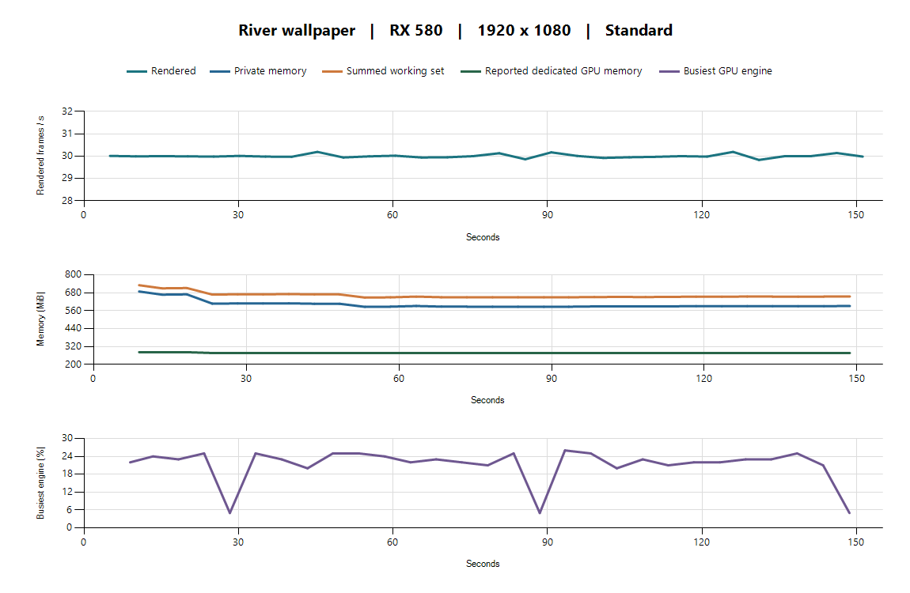

# RX 580 江湾壁纸持续绘制

2026-11-16 在 Windows 的 1920 × 1080 主屏运行基于 `9ea58d4` 的游戏。使用标准画质、独立存档和 WebView2 的 D3D11 硬件渲染，在江湾的三张场景贴图全部载入后开始计时。壁纸保持挂在桌面图标后方，交互窗保持隐藏。本轮五秒检查一次屏幕上均匀分布的 35 个点，31 次检查中都没有点命中桌面层。实测覆盖的是壁纸被前方窗口遮挡时的持续绘制。帧数取自游戏自己的画布，显示器实际呈现的帧数未测量。

| 指标 | 本轮实测 |
| --- | --- |
| 画布与绘制时间 | 1920 × 1080，151.1854 秒，共 4,536 帧 |
| 平均绘制帧率 | 30.00 帧/秒，30 个五秒区间为 29.83–30.19 帧/秒 |
| 游戏进程私有内存 | 首次 689.27 MiB，最后 591.60 MiB，最低 585.99 MiB |
| 游戏进程工作集之和 | 首次 731.35 MiB，最后 655.54 MiB，最低 648.29 MiB |
| 游戏进程最忙 GPU 引擎 | 29 次采样平均 21.21%，范围 5–26% |
| 游戏进程报告的专用显存 | 平均 276.73 MiB，范围 276.07–281.93 MiB |

内存和显卡采样从第 8.94 秒延续至第 148.61 秒。每次内存采样含游戏宿主和专属浏览器子进程，共八个进程。其中一个进程提供可用的显卡计数器。工作集相加可能重复计算共享页，显卡计数器取游戏进程在同一引擎上的报告值。表中的引擎负载不代表整张显卡的占用率。结束时正常撤下壁纸，独立测试进程全部退出。本轮时间不足以判断数小时运行时的内存趋势。



[逐次取样数值](river-wallpaper-1080p.json)

## 复测

在仓库根目录执行。使用已经解包的 WebView2 SDK 和仓库外已有的临时目录。

```powershell
./diagnostics/dual-window/test-webviews.ps1 -GameWallpaperSoak -GameWallpaperPrepare -SdkDirectory $sdk -OutputDirectory $output
```

脚本以普通游戏切换地图的方式进入江湾，撤销交互，再对壁纸计时。外部采集器只保留该宿主及其专属子进程。输出目录中的 `wallpaper-soak-frames.json` 逐次记录渲染帧及桌面命中点数，`wallpaper-soak-report.json` 对齐同一时段内的帧数与内存/显卡取样。若探测时桌面已有可用图层，可省略 `-GameWallpaperPrepare`。
